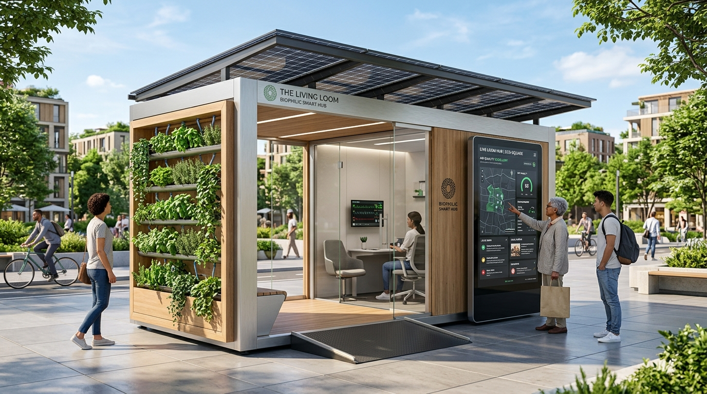

# CivicAI / CivicPulse AI — Smart Community Intelligence Platform

> **Tagline:** Report. Predict. Resolve. Transform.  
> **Repository:** [gsrilakshmi002-bit/civicPulse-AI](https://github.com/gsrilakshmi002-bit/civicPulse-AI)  
> **Architecture & Visual Concept:** The Living Loom Biophilic Smart-City Micro-Hub

---

## 🌟 Concept Showcase: "The Living Loom"



**The Living Loom** is an urban infrastructure micro-hub engineered to bridge physical civic spaces with digital community intelligence. Sized like a modern bus shelter, it integrates:
- 🌿 **Living Vertical Hydroponic Gardens** cultivating fresh herbs and bio-filtering particulate air pollution ($PM_{2.5}$).
- ☀️ **Photovoltaic Solar Glass Canopy & Kinetic Pavers** harvesting clean renewable power.
- 📱 **Interactive AI Civic Screen** providing real-time municipal status tracking, hazard maps, and reporting.
- 🩺 **Private Telehealth Consultation Booth** delivering accessible neighborhood wellness diagnostics.

---

## 🎯 Executive Summary & Objectives

**CivicPulse AI** addresses real-world municipal problems through artificial intelligence, data analytics, explainable prioritization, and predictive insights.

The platform empowers **citizens** to report community infrastructure failures (garbage overflows, potholes, broken streetlights, water pipeline leaks, drainage blockages) while equipping **administrators** and **community analysts** with intelligent triage tools to identify recurring hotspots, detect duplicates, and optimize municipal resource dispatch.

---

## 🚀 Key Innovation Highlights

### 1. Explainable AI Priority Scoring (0–100)
Every submitted complaint receives a transparent priority score based on:
- 🛡️ **Safety Hazard Risk (0–35):** Evaluates electrocution risk, road craters, potable main bursts, or school/hospital zones.
- 👥 **Citizen Exposure (0–25):** Assesses commuter density, arterial corridors, and residential population impact.
- 🔁 **Recurrence / Hotspot Index (0–25):** Cross-references historical 30-day clustering in the same ward/locality.
- ⏳ **Aging Baseline (0–15):** Tracks ticket turnaround against municipal SLA baselines.

### 2. Intelligent Duplicate Complaint Detection & 1-Click Merging
- Combines token Jaccard similarity and string sequence matching with ward and geolocation proximity.
- Identifies cluster reports (e.g., multiple citizens reporting the same garbage pile on Maple Street).
- Administrators can review duplicate similarity percentages and merge them into one primary master dispatch ticket.

### 3. Real-Time Tracking & Official Audit Timeline
- Five-stage tracking pipeline: `Submitted` ➔ `Under Review` ➔ `Assigned` ➔ `In Progress` ➔ `Resolved`.
- Preserves a timestamped audit trail of municipal status updates, assigned departments, and explicit rejection justifications.

### 4. Grounded AI Community Assistant
- Powered by a Retrieval-Augmented civic model connected live to the municipal SQLite database.
- Answers statistical queries (*"How many complaints are pending?"*, *"What is the most reported issue?"*) using verified application data with zero hallucination.

### 5. Predictive Volume Forecasting & Trend Analytics
- Analyzes historical monthly complaints using linear regression and seasonal meteorological indices (e.g. monsoon drainage surges).
- Clearly labeled as synthetic demonstration data for responsible AI governance.

### 6. Environmental Sustainability Module
- Dedicated audits for solid waste management, drinking water leakages, drainage siltation, and plastic recovery.
- Computes estimated liters of potable water conserved and avoided carbon emissions ($CO_2e$).

---

## 👥 Three Tailored User Experiences

| Role | Capabilities |
| :--- | :--- |
| **Citizen** | Log complaints with photos, preview real-time AI priority scores, track ticket timelines, upvote community issues. |
| **Administrator** | Triage full complaint registry, override AI priority scores, assign departments, merge duplicate reports, reset demo data. |
| **Community Analyst**| Analyze ward heatmaps, examine predictive forecast models, and review environmental sustainability KPIs. |

---

## 🏗️ System Architecture

```mermaid
graph TD
    Client["Frontend Web Application (React 19, TypeScript, Vite, Tailwind CSS)"]
    API["FastAPI REST Backend Server (Uvicorn @ http://127.0.0.1:8000)"]
    DB[("SQLite Database Store (civicai.db)")]
    AI["AI Services (Gemini API + Deterministic Heuristic NLP Engine)"]
    
    Client -->|HTTP / REST (CORS)| API
    API -->|CRUD & History| DB
    API -->|Classification & Triage| AI
```

---

## 🛠️ Technology Stack

- **Frontend:** React 19, TypeScript, Vite, Tailwind CSS, Custom SVG Chart Components, Plus Jakarta Sans typography.
- **Backend:** Python 3.13, FastAPI, Uvicorn, Pydantic, SQLite3, Requests.
- **AI & NLP:** Google Gemini 1.5 API with built-in heuristic rule-based NLP fallback engine.
- **Analytics:** Real-time SQL aggregations, seasonal weather multipliers, and linear trend projection.

---

## ⚡ Quick Start & Local Setup

### Prerequisites
- Node.js (v18+)
- Python (v3.10+)

### 1. Start the Backend API Server
```bash
cd backend
python -m uvicorn main:app --host 127.0.0.1 --port 8000 --reload
```
- API Base: `http://127.0.0.1:8000`
- Interactive Swagger API Documentation: `http://127.0.0.1:8000/docs`

### 2. Start the Frontend Application
```bash
cd frontend
npm install --legacy-peer-deps
npm run dev
```
- Web Application: `http://127.0.0.1:5173`

---

## 🧪 Demonstration Walkthrough for Hackathon Judges

1. **Submit Complaint:** Go to *Submit Complaint*, enter *"Dangerous deep pothole near school gate"*, and click **Preview AI Classification**. Observe the calculated safety score and departmental routing.
2. **Review Duplicates:** Go to *Admin Console*, inspect ticket `#CIV-2024-00101` (Maple Street garbage overflow), click **Duplicates**, and execute a 1-click merge of similar complaints.
3. **Query AI Assistant:** Open *AI Community Bot* and ask *"What is the most reported issue in the city?"* to see live SQLite query execution.
4. **Predictive Analytics:** Open *AI Analytics* to view monthly resolution velocity and upcoming quarter forecast estimates.

---

## 📜 License & Compliance
Built for smart community intelligence and municipal public good. Labeled with synthetic demonstration datasets.
